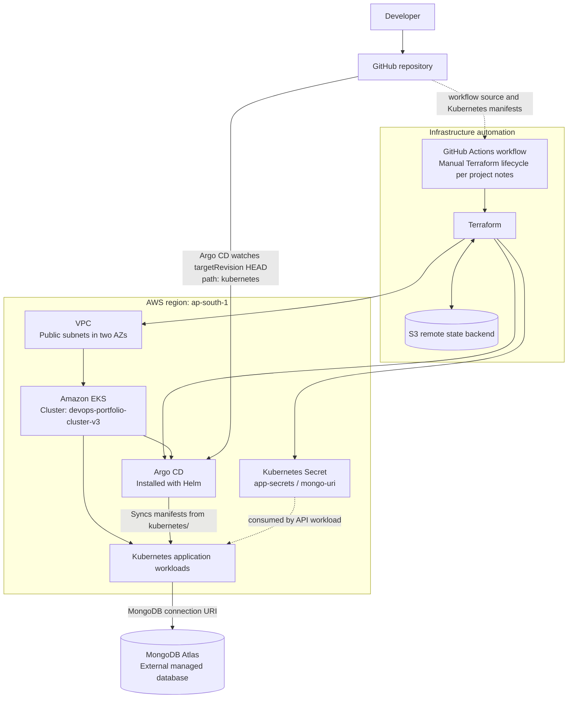

# Cloud-Native 3-Tier Application: Terraform, Amazon EKS & GitOps

A hands-on DevOps portfolio project documenting the evolution of a containerised application from an EC2/Docker Compose deployment toward Kubernetes on Amazon EKS, with Terraform for infrastructure provisioning and Argo CD for GitOps-style application synchronisation.

> **Project status:** This is a learning and portfolio project, not a production-ready platform. The repository contains both historical implementation notes and the current Terraform configuration. Read the status and security notes below before trying to reproduce the environment.

## Overview

The project explores how to provision cloud infrastructure as code, run containerised application workloads on Kubernetes, and use a GitOps controller to reconcile Kubernetes manifests from a Git repository.

The current Terraform configuration in [`infrastructure/main.tf`](infrastructure/main.tf) defines an AWS VPC, an Amazon EKS cluster, a Kubernetes Secret for the MongoDB connection string, and Helm releases for Argo CD and the Argo CD applications chart. The Argo CD Application configuration points to this repository's `kubernetes/` directory.

The repository's existing project notes describe the application as three tiers:

- **Web/UI service:** Node.js and Express.js.
- **API service:** Python and Flask.
- **Database:** MongoDB Atlas, managed outside the Kubernetes cluster.

The exact application image build and publishing steps are part of the project's earlier CI/CD history. The infrastructure configuration alone does not build container images; the image references in the Kubernetes manifests must point to images that are already available in a registry.

## What this project demonstrates

- Defining AWS infrastructure with Terraform.
- Configuring a VPC and public subnets for an EKS cluster.
- Managing Terraform state through an S3 backend.
- Deploying Argo CD using Terraform's Helm provider.
- Defining an Argo CD Application that watches Kubernetes manifests in Git.
- Managing an application connection string through a Terraform variable and a Kubernetes Secret.
- Investigating infrastructure and Kubernetes provider dependency issues.
- Documenting trade-offs, security considerations, verification steps, and future improvements.

## Architecture

The diagram below represents the active flow described by the current Terraform configuration. The infrastructure workflow is documented in the project history as a manually triggered GitHub Actions workflow; confirm its current YAML before relying on the trigger details. The application image build/publish process is not shown as an active step because it is separate from the Terraform configuration.



### Application deployment flow

1. Terraform provisions the AWS infrastructure and installs Argo CD through Helm.
2. Terraform also defines the `argocd-apps` Helm release, which configures an Argo CD Application named `form-app`.
3. That Application is configured to watch this repository at `targetRevision: HEAD`, using the `kubernetes/` directory as its source path.
4. Argo CD synchronises the Kubernetes resources it finds there to the cluster according to the configured automated sync policy.
5. Terraform creates the `app-secrets` Secret in the `default` namespace with the key `mongo-uri`, sourced from the `mongo_uri` Terraform variable.
6. The API workload is expected to read that Secret and connect to MongoDB Atlas. Confirm the manifest's Secret reference and Atlas network-access configuration before treating the end-to-end connection as verified.

## Technology stack

| Technology | Role in this project | Notes |
|---|---|---|
| AWS | Cloud platform | Configuration targets `ap-south-1`. |
| Amazon VPC | Networking | Terraform defines a VPC with public subnets in `ap-south-1a` and `ap-south-1b`. |
| Amazon EKS | Kubernetes control plane | Cluster name in Terraform: `devops-portfolio-cluster-v3`. |
| Terraform | Infrastructure as Code | Main configuration and provider/variable declarations are in `infrastructure/main.tf`. |
| Amazon S3 | Terraform state backend | Backend key is `infrastructure/terraform.tfstate`; the configured bucket must exist and be accessible. |
| Kubernetes | Application orchestration | Argo CD reads manifests from `kubernetes/`. |
| Helm | Kubernetes package management | Terraform installs Argo CD and the Argo CD applications chart. |
| Argo CD | GitOps reconciliation | Application automation has `prune: true` and `selfHeal: true` in the Terraform-defined application values. |
| GitHub Actions | Infrastructure workflow | Project notes describe a manual Terraform workflow. Check the actual workflow file for current triggers and inputs. |
| Node.js / Express | UI/service layer | Identified as the UI layer in the repository's project notes. |
| Python / Flask | REST API layer | Identified as the API layer in the repository's project notes. |
| MongoDB Atlas | External database | Connection string is passed through the `mongo_uri` Terraform variable. |
| Docker / Docker Compose | Earlier containerisation and deployment phase | Historical project phase; not a replacement for the current Kubernetes deployment path. |
| Jenkins | Earlier CI/CD deployment approach | Documented as a legacy phase and commented out in portions of the current Terraform file. |
| Prometheus / Grafana | Monitoring exploration | The previous project notes describe use of `kube-prometheus-stack` through Helm. The current `infrastructure/main.tf` reviewed for this README does not define an active Prometheus/Grafana Helm release, so this README does not claim a currently verified monitoring deployment. |

## Repository layout

The public repository currently exposes these top-level directories and files:

```text
.
├── .github/
│   └── workflows/       # GitHub Actions workflow files
├── application/         # Application source/build assets
├── deployment/          # Deployment-related assets
├── infrastructure/
│   └── main.tf          # Terraform providers, backend, variables and resources
├── kubernetes/          # Kubernetes manifests watched by Argo CD
├── .gitignore
└── README.md
```

The exact filenames inside each application, deployment, workflow, and Kubernetes directory can change as the project evolves. Refer to the files in the branch you are using rather than relying on copied filenames from older notes.

## Infrastructure configuration confirmed in Terraform

The following details are visible in the current public [`infrastructure/main.tf`](infrastructure/main.tf):

| Setting | Configured value |
|---|---|
| AWS region | `ap-south-1` |
| Terraform backend | S3 |
| State key | `infrastructure/terraform.tfstate` |
| VPC CIDR | `10.0.0.0/16` |
| Public subnet CIDRs | `10.0.1.0/24`, `10.0.2.0/24` |
| EKS cluster name | `devops-portfolio-cluster-v3` |
| Kubernetes version | `1.36` |
| EKS node group | `app_nodes` |
| Desired node count | `1` |
| Node count range | `1`–`2` |
| Node instance type | `t3.medium` |
| Argo CD Helm chart version | `5.51.6` |
| Argo CD applications chart version | `1.6.2` |
| Argo CD Application name | `form-app` |
| Argo CD source path | `kubernetes` |
| Application destination namespace | `default` |
| Kubernetes Secret name | `app-secrets` |
| Kubernetes Secret key | `mongo-uri` |

These are configuration values, not proof that an AWS cluster is currently running or that every workload is healthy. Confirm the AWS and Kubernetes state using the verification commands below.

## Prerequisites

To reproduce the infrastructure, you will need:

- An AWS account with permission to create the VPC, EKS resources, managed node group, IAM resources and related infrastructure.
- AWS CLI configured with credentials for the intended AWS account.
- Terraform installed at a version compatible with the providers configured in `infrastructure/main.tf`.
- Git, `kubectl`, and Helm for source control and local verification.
- A GitHub token suitable for the configured Terraform GitHub provider.
- A MongoDB Atlas connection string if you want the API to connect to the database.
- The container images referenced by the Kubernetes manifests published to a registry accessible by the cluster.

The Terraform configuration does not declare a `required_version` constraint for the Terraform CLI. Check provider compatibility and run `terraform init` and `terraform validate` in your environment before provisioning.

## Configuration and secrets

The current Terraform file declares these input variables:

| Terraform variable | Purpose | How to supply it |
|---|---|---|
| `github_token` | Token used by the Terraform GitHub provider | Local environment as `TF_VAR_github_token`, or the corresponding protected GitHub Actions secret/environment mapping configured in the workflow. |
| `mongo_uri` | MongoDB Atlas connection string | Local environment as `TF_VAR_mongo_uri`, or the corresponding protected GitHub Actions secret/environment mapping configured in the workflow. |

For local use, Terraform automatically reads variables exported with the `TF_VAR_` prefix. Use your own values; the examples below are placeholders.

```bash
export TF_VAR_github_token="<your-github-token>"
export TF_VAR_mongo_uri="<your-mongodb-atlas-connection-string>"
```

Authenticate to AWS using an IAM identity with the minimum permissions required for this project. You can use an AWS CLI profile or your environment's approved credential mechanism. Never commit access keys, personal access tokens, database URIs, `.env` files, Terraform state, or secret-containing `.tfvars` files.

### Important: Terraform state contains sensitive values

The `mongo_uri` variable is marked `sensitive` in Terraform, which helps redact it from normal CLI output. However, Terraform may store the underlying value in state because the configuration creates a Kubernetes Secret from it. A remote S3 backend does **not** automatically make that data safe by itself.

Restrict access to the state bucket, enable appropriate encryption and logging, and avoid sharing state files. Review the state-management and secret-handling design before using this pattern beyond a disposable learning environment.

### Important: prepare your own S3 backend

The current backend configuration contains a project-specific bucket name directly in `infrastructure/main.tf`. Before using the project in another AWS account, replace that value with an S3 bucket you own in the configured region and ensure Terraform's AWS identity can access it. The bucket must exist before `terraform init` can initialise the backend. Keep the state bucket separate from resources managed by this configuration unless you deliberately design its lifecycle.

The current backend block specifies an S3 bucket, key and region but does not explicitly configure a state-locking mechanism. Do not assume concurrent Terraform runs are locked; configure and verify an appropriate locking approach before running this with multiple users or automation jobs.

## Getting started: local Terraform workflow

> **Cost warning:** Applying this configuration can create billable AWS resources, including an EKS cluster and EC2 worker nodes. Do not run `terraform apply` unless you understand the planned resources and costs.

1. Clone the repository and enter the infrastructure directory:

   ```bash
   git clone https://github.com/JaikumarGaja/devops-portfolio-project.git
   cd devops-portfolio-project/infrastructure
   ```

2. Configure AWS credentials and export `TF_VAR_github_token` and `TF_VAR_mongo_uri` as described above. Use the real GitHub token and MongoDB URI in your local environment; never paste them into this README or commit them.

3. Confirm that the configured S3 backend bucket exists, is in the configured region, and is accessible to your AWS identity. If you are using your own bucket, update `backend "s3"` in `main.tf` before initialising Terraform.

4. Initialise providers and the remote backend:

   ```bash
   terraform init
   ```

5. Check formatting and configuration validity:

   ```bash
   terraform fmt -check -recursive
   terraform validate
   ```

6. Review the infrastructure changes before applying them:

   ```bash
   terraform plan
   ```

7. Only after checking the plan and cost implications, apply the configuration:

   ```bash
   terraform apply
   ```

The actual GitHub Actions workflow is in `.github/workflows/`. The project's engineering log describes a manually triggered Terraform workflow (`workflow_dispatch`) for infrastructure lifecycle operations. Inspect the current workflow YAML for its actual filename, inputs, credential mapping, permissions, and apply/destroy behaviour before using it. Do not assume every push to `main` provisions or destroys infrastructure.

## Verification after provisioning

These commands check the configured cluster and resources; they do not guarantee the application will be healthy without checking the outputs.

### 1. Confirm AWS identity and cluster existence

```bash
aws sts get-caller-identity
aws eks describe-cluster \
  --region ap-south-1 \
  --name devops-portfolio-cluster-v3
```

### 2. Configure local `kubectl` access

```bash
aws eks update-kubeconfig \
  --region ap-south-1 \
  --name devops-portfolio-cluster-v3

kubectl get nodes
kubectl get pods -A
```

If access fails, check the active AWS identity and whether it is authorised to access the cluster.

### 3. Check Argo CD and the Application

```bash
kubectl get pods -n argocd
kubectl get applications -n argocd
kubectl describe application form-app -n argocd
```

The application is configured in Terraform with automated sync, pruning and self-healing. Check the live Application status and events to verify the controller has successfully reconciled the manifests. If the Application resource is not found, verify that the `argocd-apps` Helm release completed and that the chart created the expected Application.

### 4. Check workloads and the Secret

```bash
kubectl get deployments,services,pods -n default
kubectl get secret app-secrets -n default
kubectl describe pods -n default
```

Do **not** print or decode the Secret value when collecting terminal output or logs to share. If a Pod fails to start, inspect its events and logs, and check that the Secret reference in the manifest matches the `app-secrets` name and `mongo-uri` key configured in Terraform.

### 5. Test application access

The Terraform security group includes NodePort rules for ports `30000`, `30001`, and `30002`. Before testing external access, confirm the Kubernetes Services use those ports and identify the intended frontend endpoint from the actual manifests. Do not assume a port is serving traffic simply because a security-group rule exists.

For a local test, port-forward the actual frontend Service name shown by `kubectl get services -n default`:

```bash
kubectl port-forward -n default svc/<actual-frontend-service-name> 8080:<service-port>
```

Then open `http://localhost:8080`. Replace the placeholders with the real Service name and Service port from your cluster. Verify the application response and its database-dependent behaviour separately.

## Project evolution

The repository's project notes document a progression through these stages:

### Phase 1 — EC2, Docker Compose and Jenkins

The earlier version used Terraform-managed EC2 infrastructure, Docker images, Docker Compose and a Jenkins-based deployment process. GitHub Actions was documented as building/publishing container images, with Jenkins performing deployment in that historical phase.

### Phase 2 — Kubernetes and Amazon EKS

The application was migrated from a standalone Docker Compose deployment toward Kubernetes Deployments and NodePort Services on EKS. The Terraform configuration now defines a custom VPC, public subnets and an EKS managed node group.

### Phase 3 — Terraform-managed Argo CD bootstrap

The current Terraform configuration defines Helm releases for Argo CD and the Argo CD applications chart. It configures an Argo CD Application to watch the repository's `kubernetes/` directory and automatically sync changes. Jenkins is treated as a legacy approach in the newer project notes; this README does not describe Jenkins as part of the active deployment path.

### Monitoring exploration

Earlier project documentation describes installing `kube-prometheus-stack` with Helm. Since the current `infrastructure/main.tf` does not contain an active monitoring Helm release, monitoring is treated here as previous exploration rather than a currently verified part of the Terraform-managed deployment.

## Troubleshooting notes

### Terraform's Kubernetes provider tries to connect to `localhost:80`

The project notes record a failure similar to:

```text
Post "http://localhost/api/v1/namespaces/default/secrets": dial tcp [::1]:80: connect: connection refused
```

This indicates that the provider attempted to contact a local Kubernetes endpoint instead of the EKS API endpoint. The current configuration sets the Kubernetes and Helm provider hosts from `module.eks.cluster_endpoint` and the CA data from the EKS module output. It also has explicit dependencies for resources that need the cluster or installed chart.

This configuration is intended to address the dependency issue, but the fix should be verified with a clean plan/apply in a disposable environment. Terraform provider configuration and newly created cluster resources can be sensitive to dependency timing; do not claim the issue is permanently resolved until a fresh run confirms it.

### Argo CD Application does not sync

Check the following:

- Argo CD pods are ready in the `argocd` namespace.
- The repository URL, `targetRevision`, and `kubernetes/` source path match the live configuration.
- The manifests in `kubernetes/` are valid and reference images that exist in a reachable registry.
- The Application status and events identify whether the issue is authentication, manifest rendering, health, or synchronisation related.

### Pods fail to start or cannot connect to MongoDB Atlas

- Inspect Pod events and container logs without exposing secrets.
- Verify the API's `secretKeyRef` matches `app-secrets` and `mongo-uri`.
- Check that the connection string is valid and that MongoDB Atlas network access permits the application's legitimate egress path.
- Do not use a broad public network allowlist as a shortcut.

## Security and cost considerations

This configuration is for learning and should be hardened before any real-world use.

- **Public cluster endpoint:** The EKS API endpoint is configured for public access. Restrict it to trusted IP ranges or use a suitable private-access design where practical.
- **Public NodePorts:** Terraform currently permits inbound traffic from `0.0.0.0/0` to NodePorts `30000`, `30001`, and `30002`. Restrict these rules to the minimum trusted source ranges and open only the ports actually required. The Terraform comments associate these ports with the application and Grafana, but a security-group rule alone does not prove a Service is running.
- **Terraform state:** The MongoDB URI may be present in Terraform state. Protect the S3 bucket and state access, and avoid publishing state files or plan files containing sensitive values.
- **Credentials:** Do not commit AWS credentials, GitHub tokens, database URIs, Kubernetes Secret values, `.env` files or secret-bearing `.tfvars` files.
- **Application transport:** The current project notes identify lack of TLS/SSL and a NodePort exposure as limitations. Use HTTPS/TLS and a suitable ingress/load-balancing setup before exposing an actual application to users.
- **Cloud costs:** EKS and EC2 worker nodes incur charges while running. Other resources can add costs depending on the final configuration. Review the Terraform plan and AWS billing/cost explorer before and after testing.
- **Cleanup:** Destroy only resources that belong to this learning project and only after reviewing the plan. Verify in the AWS Console that no billable resources remain. The S3 state bucket is a prerequisite for the configured backend and should not be casually deleted as part of cleanup.

The current Terraform configuration also grants the cluster creator admin permissions. Use a dedicated least-privilege identity for experimentation and review access configuration before reusing this design.

## Current limitations

- This is a learning project rather than a hardened production platform.
- The Kubernetes manifests and workflow files should be checked against the current branch before following the runbook; this README deliberately avoids relying on unverified nested filenames.
- The current infrastructure configuration opens several NodePorts publicly; this should be narrowed.
- An ALB/Ingress and TLS termination are not defined in the current `infrastructure/main.tf` reviewed for this README.
- The presence of a Helm-installed monitoring stack in historical notes does not establish that Prometheus/Grafana are currently deployed and collecting validated metrics.
- A Terraform apply or successful Argo CD sync does not independently prove that every application feature or database operation works. Perform application-level checks.

## Future improvements

These are proposed next steps, not claims of completed functionality:

1. Restrict EKS endpoint and NodePort access.
2. Introduce HTTPS/TLS using an appropriate ingress/load-balancing architecture.
3. Verify and document a clean, repeatable infrastructure bootstrap and teardown.
4. Improve Terraform state access controls and configure/verify state locking for the chosen backend approach.
5. Add explicit health checks and a reproducible application test procedure.
6. Revisit Prometheus/Grafana only after verifying what is installed and configuring a small, testable set of metrics and dashboards.
7. Extend the application with the planned asynchronous queue architecture (React, Node.js, Redis, Python worker, and MongoDB) only after the current deployment is reproducible and understood.

## Learning outcomes

This project has provided practice with:

- Terraform configuration for AWS networking and EKS.
- Remote Terraform state configuration using S3.
- Kubernetes Deployments, Services, configuration and Secret references.
- Helm-based installation of Argo CD and declarative application registration.
- GitOps concepts including automated reconciliation, pruning and self-healing.
- Debugging infrastructure/provider dependency issues and documenting recovery steps.
- Reviewing access exposure, secret handling, repeatability, and cloud costs.

The project is a portfolio demonstration of hands-on learning. It should not be interpreted as professional production operations experience or as evidence of production-grade availability.

## References

- [Repository](https://github.com/JaikumarGaja/devops-portfolio-project)
- [Terraform configuration](https://github.com/JaikumarGaja/devops-portfolio-project/blob/main/infrastructure/main.tf)
- [Amazon EKS Kubernetes version lifecycle](https://docs.aws.amazon.com/eks/latest/userguide/kubernetes-versions.html)
- [Terraform sensitive data guidance](https://developer.hashicorp.com/terraform/language/manage-sensitive-data)
- [Terraform S3 backend](https://developer.hashicorp.com/terraform/language/backend/s3)
- [Argo CD documentation](https://argo-cd.readthedocs.io/en/stable/)

---

**Author:** Jaikumar Gaja  
**Project type:** Personal DevOps learning and portfolio project
